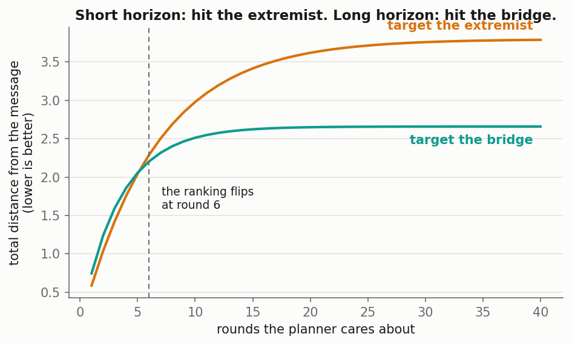
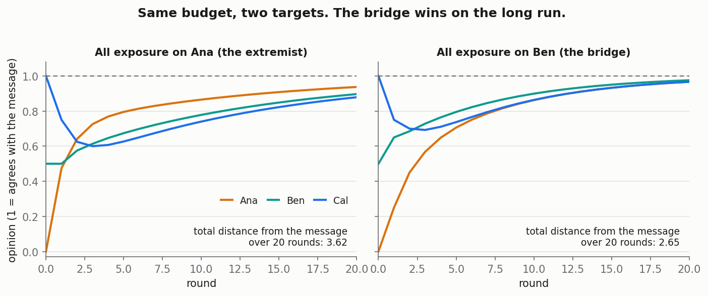
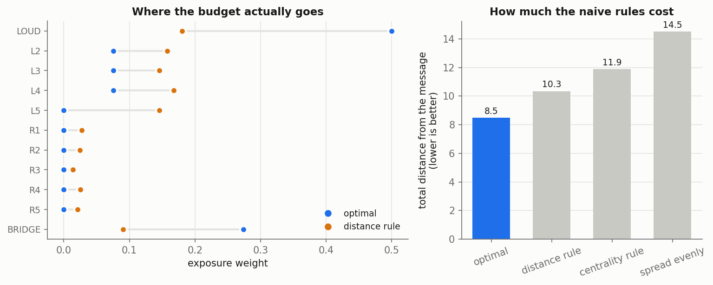
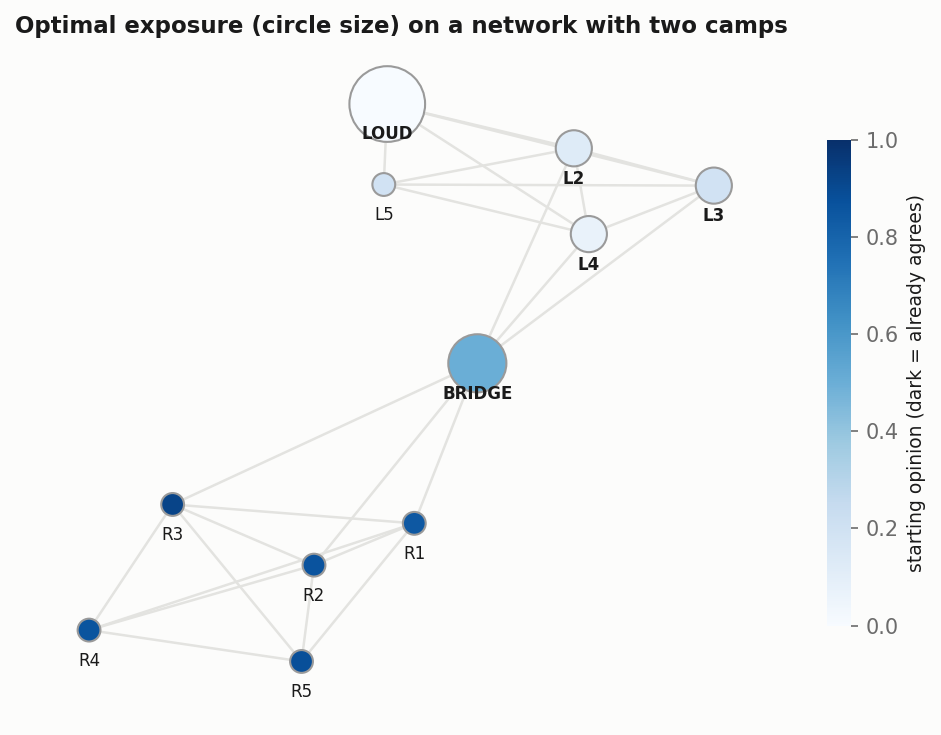

```{python}
#| echo: false
import sys; sys.path.insert(0, "../src")
import numpy as np
import matplotlib.pyplot as plt
from targeting import (simulate, loss, line3, row_normalise,
                       optimal_weights, static_rule, centrality_rule,
                       eig_centrality)
BLUE, ORANGE, TEAL, MUTED = "#1f6feb", "#d9730d", "#0f9b8e", "#6b6b6b"
```

## The problem {.smaller}

You run a campaign. You have **one message**, the same for everyone, and you cannot
personalise it. Privacy rules, platform policy and plain reputational risk all push
in that direction.

The only thing you control is **how much each person sees it**.

Who do you aim at?

Write down your guess before running anything. Most people say: the people who
disagree most.

::: {.notes}
This lesson follows Li and Solimine, "Targeting persistent disagreement: coarse
interventions in social networks" (ACM EC 2026). The simulation here is a
simplified teaching version, not the paper's exact formulation.
:::

## Step 1: opinions on a network

Everyone holds an opinion between 0 and 1. Each round, you become a weighted
average of the people you listen to. That is DeGroot learning, and it is one line
of code.

$$x(t+1) = A\,x(t)$$

$A$ is the **listening matrix**: row $i$ says how much weight person $i$ puts on
each person, and each row sums to 1.

Three people in a line. Ana listens to herself and Ben. Ben listens to everyone.
Cal listens to himself and Ben.

```{python}
A, x0, names = line3()
print(np.round(A, 2))
print(dict(zip(names, x0)))
```

Ana starts at 0 (opposed), Ben at 0.5 (undecided), Cal at 1 (already agrees).

```{python}
#| fig-cap: "With no campaign at all, the three of them meet in the middle."
path = simulate(A, x0, b=np.zeros(3), T=20)
fig, ax = plt.subplots(figsize=(6, 3))
for i, (n, c) in enumerate(zip(names, [ORANGE, TEAL, BLUE])):
    ax.plot(path[:, i], color=c, lw=2, label=n)
ax.legend(frameon=False); ax.set_xlabel("round"); ax.set_ylabel("opinion")
plt.show()
```

Notice where they land: the average, not the truth. Left alone, nobody ends up at 1.

## Step 2: add the broadcast

Now the planner broadcasts a message $m = 1$. Person $i$ has an **exposure weight**
$b_i$, the share of their update that comes from the message rather than from
their friends.

$$x(t+1) = (I - B)\,A\,x(t) + B\,m, \qquad B = \mathrm{diag}(b)$$

The planner has a fixed budget to spread across people, and picks $b$ once, at the
start.

## Step 3: the experiment

Same budget, 0.3 of exposure. Two choices:

- **Policy A:** all of it on Ana, the extremist.
- **Policy B:** all of it on Ben, the undecided bridge.

Run one round and score each policy by the total squared distance from the message.

```{python}
b_ext    = np.array([0.3, 0.0, 0.0])
b_bridge = np.array([0.0, 0.3, 0.0])
for T in (1, 3, 6, 12, 20):
    print(f"T={T:<3} extremist {loss(A, x0, b_ext, T=T, delta=1.0):.3f}"
          f"   bridge {loss(A, x0, b_bridge, T=T, delta=1.0):.3f}")
```

## Step 4: the flip



After one round, targeting the extremist wins. By round 6 the ranking flips, and
after 20 rounds the bridge is far ahead.

**Why.** When you push Ana, her shift reaches Ben at only one third weight, and Cal
drags Ben back the other way. When you push Ben, his shift leaks to Ana *and* Cal,
every round. The bridge compounds. The extremist does not.



## Step 5: a real network

Two camps. The left camp opposes the message and contains **LOUD**, who is both the
most extreme and the best connected inside that camp. The right camp already agrees.
One **BRIDGE** node sits between them with a middling opinion.

Now solve for the whole exposure vector numerically, under a budget, and compare it
against two rules people actually use:

- the **distance rule**: exposure proportional to how far someone is from the message
- the **centrality rule**: exposure proportional to eigenvector centrality





## What the optimum does {.smaller}

Three things, none of them obvious:

1. **It spends nothing on the people who already agree.** The distance rule still
   sends 11% of the budget to the friendly camp. Pure waste.
2. **It buys the gateway.** The bridge gets three times the exposure the distance
   rule would give it, and three times what centrality would give it, despite
   having fewer connections than anyone in either camp.
3. **It is lumpy.** The optimum concentrates on two nodes and zeroes out the rest.
   Both naive rules spread exposure thinly over everyone.

Measured against the optimum, the distance rule gives up about 22% and the
centrality rule about 40%.

The paper's version of this point: applied to US climate beliefs on a state-level
friendship network, Texas gets substantially more targeting than California even
though the two states are about equally central.

## Exercises

1. Make the bridge better connected (raise `bridge_links`). At what point does it
   overtake LOUD as the top target?
2. Set the discount factor to 0.5 so the planner is impatient. Does the optimum
   move back toward the extremist?
3. Replace the two-camp network with a hub-and-spoke. Predict the optimum before
   you run it.
4. Give one agent a weight of 1 on itself, so it never listens to anyone. What
   happens to the exposure it receives, and why?

## Source

Wei Li and Philip Solimine, "Targeting persistent disagreement: coarse
interventions in social networks," *Proceedings of the 27th ACM Conference on
Economics and Computation* (EC 2026).

The model here is a simplified teaching version. The paper solves the planner's
problem analytically, with a value function and a Riccati matrix, and characterises
the optimum in terms of the network's eigenvectors.
